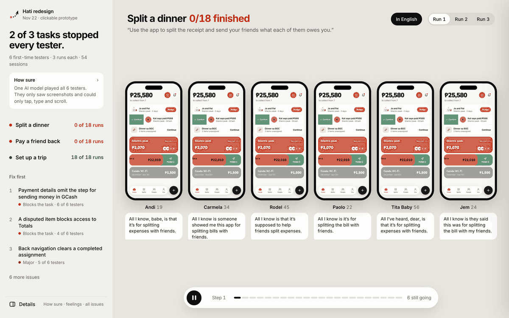

<p align="center">
  
</p>

<h1 align="center">Pilot</h1>

<p align="center">
  We created Pilot to test any UX like real first-time users,<br>
  so that you can fix it with your coding agent before shipping.
</p>

<p align="center">
  <a href="#quickstart">Quickstart</a> ·
  <a href="#what-you-get">What you get</a> ·
  <a href="#the-loop">The loop</a> ·
  <a href="#how-well-it-works">How well it works</a> ·
  <a href="#honest-limits">Honest limits</a>
</p>

<p align="center">
  
</p>

Testers who have never seen your app try to do one thing in it. Each one sees only screenshots, thinks aloud, and gives up when they would. You watch every attempt side by side, then hand the fixes to your coding agent.

## Quickstart

In Claude Code:

```
/plugin marketplace add itsalexi/pilot-ux
/plugin install pilot@pilot
```

Then ask:

```
Use Pilot to test whether a new user can sign up on http://localhost:3000
```

Pilot drafts the tasks, picks contrasting testers, runs them, and writes the report. Name the audience and tasks yourself, or let it draft them from your app.

It tests a URL, a repo, linked HTML pages, design artboards or screenshots, an iOS Simulator app, or a written idea.

## What you get

### `pilot.html`

The report above. Every problem is ranked by how bad it is and how many testers hit it, with the exact screens and words behind it. One file, works offline, ready to send.

### `fix-plan.md`

The same findings, written for your coding agent. Each problem is a complete brief.

```markdown
## 1. Payment details omit the step for sending money in GCash

How bad: blocks the task. All 6 testers hit it, in 18 of 18 sessions.

In their words:
- Tita Baby, 56, step 5: "I can see my share, but I can't tell where to send it on GCash."
- Carmela, 34, step 7: "Maybe the QR opens GCash. It's on this same phone,
  so I can't point my camera at it."

Suggested fix: Place a short instruction above "I've paid" that says
"Copy Alexi's number, open GCash, and send ₱868. Then return here."
Fixed when: a first-time tester doing "Pay a friend back" gets past
this point without stalling or giving up.

Retest:
  pilot all fixed.yaml --only friend-pay
  pilot recheck runs/redesign runs/redesign-fixed
```

Hand it to Claude Code or Codex and ask it to work through the list.

## The loop

**Find.** Run Pilot on the current build and keep it as the baseline.

**Fix.** Your coding agent takes the top problem from `fix-plan.md`.

**Retest.** Fresh testers run the same tasks on the new build, and `recheck` compares the two.

```bash
pilot all fixed.yaml --only friend-pay
pilot recheck runs/baseline runs/baseline-fixed
```

### Hati, before and after

Hati is a bill-splitting app. Its redesign went through this loop once.

<!-- PLACEHOLDER: Hati fix-and-retest numbers. Replace every TBD before launch. -->

| Task | Before | After |
| --- | --- | --- |
| Split a dinner | 0 of 18 | **TBD** |
| Pay a friend back | 0 of 18 | **TBD** |
| Set up a trip | 18 of 18 | **TBD** |

> **Placeholder.** The retest is still running. These numbers land before launch.

## How well it works

Measured on Hati, one app, with small samples. Read these as early evidence, not a benchmark.

| Check | Result |
| --- | --- |
| Known problems found, against an earlier human QA walkthrough of the old app | **4 of 13** |
| Reported problems that weren't on screen | **0 of 23** |
| Same outcome when a tester repeats a task | **54 of 54** pairs |
| Overlap of the problems found across repeats | **0.85** (Jaccard) |

An AI reviewer checked every reported problem against its screenshots. No independent human adjudicated them.

## How it works

Each tester runs in its own Claude or Codex process, in an empty folder, with only a device to drive. It never sees your code, your notes, or the expected path.

After the sessions, separate agents check the work. A verifier sees only the screens from each session, never what the tester said, and decides whether the task really succeeded. An annotator rates each problem from 0 to 4. A merger counts how many testers hit it.

Each tester also answers a short interview in character. Pilot scores those answers with Semantic Similarity Rating, which turns free text into a 1 to 5 distribution instead of a single number.

## Honest limits

**Synthetic testers are more patient and literal than people.** They read every word and rarely quit. Use Pilot before you test with real people, not instead of it.

**They see only screenshots.** Small text can be misread, and the report flags suspected misreads.

**A failure is a strong signal. A pass is weak evidence.** If a tester gets stuck, a real person probably will too. If every tester succeeds, real people still might not.

**Personas change behavior, not identity.** A tester who speaks Taglish checks your copy in that register. It does not stand in for real people.

**SSR was validated on purchase intent.** The ease, trust and SUS scores use the same method without their own human validation.

## Setup

- [uv](https://docs.astral.sh/uv/)
- A Claude Code or Codex login
- Google Chrome or Playwright Chromium, for web apps
- For SSR, `OPENAI_API_KEY` with the `[openai]` extra, or a `local:` embedder such as `local:all-MiniLM-L6-v2` with the `[local]` extra

From a checkout, without installing the plugin:

```bash
claude --plugin-dir .
```

Or from the command line, on a sample plant-watering app with planted problems:

```bash
uv run pilot all examples/smoke/study.yaml
```

Run with `--dry-run` first to see how many sessions a study will start. Settings use the `PILOT_` prefix, such as `PILOT_STORAGE_STATE` for a signed-in browser. The older `UX_SWARM_` names still work.

## Privacy

Testers and analysis run on the model backend you choose. A remote embedder receives the interview answers. Reports contain screenshots of your app, so share them like screenshots. Run folders, sign-in files and `.env` files are ignored by git.

## Citations

- Maier, Aslak, Fiaschi, Rismal, Fletcher, Luhmann, Dow, Pappas and Wiecki. *LLMs Reproduce Human Purchase Intent via Semantic Similarity Elicitation of Likert Ratings.* 2025. [arXiv:2510.08338](https://arxiv.org/abs/2510.08338)
- Lu et al. *UXAgent: An LLM Agent-Based Usability Testing Framework for Web Design.* CHI EA 2025. [arXiv:2502.12561](https://arxiv.org/abs/2502.12561)
- Holter, Koh, Dogan and Chan. *UXCascade: Scalable Usability Testing with Simulated User Agents.* UIST 2026. [arXiv:2601.15777](https://arxiv.org/abs/2601.15777)
- Brooke. *SUS: A "quick and dirty" usability scale.* 1996. Nielsen, severity ratings, 1994.

To cite Pilot, see [`CITATION.cff`](CITATION.cff).

## License

MIT
